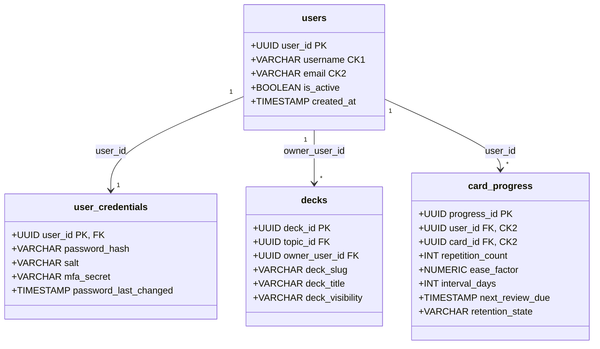

# Advanced Programming (AP) — Database Management Systems (DBMS)
## Checkpoint 1 (CP1): Formal Relational Normalization Report
### Project: **Cognify** — Adaptive Cognitive Training & Spaced-Repetition Platform
**Team Identifier:** T0004  
**Academic Year:** 2026  
**Document Path:** `dbms/01_normalization.md`  

---

## Table of Contents
1. [Executive Summary & System Architecture](#1-executive-summary--system-architecture)
2. [Domain Scope & Application Entities](#2-domain-scope--application-entities)
3. [Universal Relation & Unnormalized Form (UNF)](#3-universal-relation--unnormalized-form-unf)
4. [First Normal Form (1NF) Transformation](#4-first-normal-form-1nf-transformation)
5. [Functional Dependency (FD) Analysis & Attribute Closures](#5-functional-dependency-fd-analysis--attribute-closures)
6. [Second Normal Form (2NF) Transformation](#6-second-normal-form-2nf-transformation)
7. [Third Normal Form (3NF) Transformation](#7-third-normal-form-3nf-transformation)
8. [Boyce-Codd Normal Form (BCNF) Analysis & Proofs](#8-boyce-codd-normal-form-bcnf-analysis--proofs)
9. [Final Normalized Relational Schema Specification](#9-final-normalized-relational-schema-specification)
10. [Derived and Redundant Attributes: Architectural Trade-Off Analysis](#10-derived-and-redundant-attributes-architectural-trade-off-analysis)
11. [Summary & Checkpoint 1 Sign-Off](#11-summary--checkpoint-1-sign-off)

---

## 1. Executive Summary & System Architecture

### 1.1 Context & Objective
**Cognify** is an enterprise-grade adaptive learning and cognitive assessment platform designed for college students and lifelong learners. The core engine applies algorithmic spaced-repetition models (specifically an optimized variant of the SuperMemo SM-2 and Free Spaced Repetition Scheduler [FSRS] algorithms), timed recall drills, dynamic cognitive load adjustments, and granular response latency analytics.

The objective of **Checkpoint 1 (CP1)** is to establish a mathematically rigorous, fully normalized relational schema for Cognify. The schema must guarantee data integrity, eliminate update/insert/delete anomalies, preserve all functional dependencies, support lossless-join decompositions, and strictly balance transactional efficiency (OLTP) with analytical expressiveness.

### 1.2 Normalization Progression Roadmap
The relational decomposition follows formal Codd relational database theory:

```text
[UNF] --(Atomic domains / Flatten repeating groups)--> [1NF]
      --(Eliminate partial key dependencies)----------> [2NF]
      --(Eliminate transitive dependencies)-----------> [3NF]
      --(Enforce strict superkey determinants)---------> [BCNF]
```

```mermaid
flowchart LR
    UNF["UNF\n(Nested records, repeating groups)"] -->|"Atomic Domains\nNo Multi-Valued Attributes"| NF1["1NF\n(Scalar values, primary key assigned)"]
    NF1 -->|"Remove Partial Dependencies\n(Non-prime fully dep on CK)"| NF2["2NF\n(Separate sub-entities from composite keys)"]
    NF2 -->|"Remove Transitive Dependencies\n(Non-prime cannot determine non-prime)"| NF3["3NF\n(X -> Y: X is Superkey OR Y is Prime)"| NF3
    NF3 -->|"Strict Superkey Determinancy\n(For all X -> Y, X must be Superkey)"| BCNF["BCNF\n(Anomaly-free relational design)"]
```

---

## 2. Domain Scope & Application Entities

Cognify's backend domain models data across six core sub-systems:

| Sub-System | Primary Responsibilities | Entities Involved |
| :--- | :--- | :--- |
| **1. Identity & Access (IAM)** | User authentication, session security, role-based access control (RBAC). | `users`, `user_credentials`, `roles`, `user_roles` |
| **2. Profiles & Baseline** | User demographic preferences, personalized cognitive baseline scores. | `user_profiles`, `cognitive_baselines` |
| **3. Content Hierarchy** | Taxonomic organization of knowledge domains, flashcard decks, multi-modal card items. | `topics`, `decks`, `cards`, `card_media` |
| **4. Spaced Repetition Engine** | Per-user card recall intervals, stability factors, retention history, SM-2 state. | `card_progress` |
| **5. Drill Sessions & Execution Logs** | Active test runs, micro-level response latency logs, subjective quality ratings. | `study_sessions`, `review_logs` |
| **6. Gamification & Audit Trail** | Milestone unlock events, system audit trails for data integrity. | `achievements`, `user_achievements`, `audit_logs` |

---

## 3. Universal Relation & Unnormalized Form (UNF)

### 3.1 Definition of the Universal Relation
In Unnormalized Form (UNF), the entire state of Cognify is conceived as a single monolithic relation containing non-atomic fields, multi-valued attributes, nested records, and repeating sub-tables.

In standard database textbook convention (Elmasri & Navathe format), repeating groups and nested relations are clearly denoted using parentheses with an asterisk `( ... )*`:

```text
R_UNF (
    user_id, username, email, password_hash, salt, mfa_secret,
    first_name, last_name, timezone, daily_goal_minutes,
    working_memory_score, processing_speed_ms,
    (role_id, role_name, role_description)*,
    (deck_id, deck_title, deck_slug, deck_visibility, 
     topic_id, topic_name, topic_category,
        (card_id, front_prompt, back_solution, card_type, card_difficulty,
            (media_id, media_url, media_type)*,
            repetition_count, ease_factor, interval_days, next_review_due, retention_state
        )*
    )*,
    (session_id, session_start, session_end, session_mode,
        (review_id, card_id, rating, reaction_time_ms, is_correct, review_timestamp)*
    )*,
    (achievement_id, badge_name, badge_tier, xp_value, awarded_at)*,
    (log_id, action_name, ip_address, user_agent, logged_at)*
)
```

#### Hierarchical Breakdown of Nested Repeating Groups

| Component | Nature | Contained Attributes | Reason for UNF Violation |
| :--- | :--- | :--- | :--- |
| **Base User Attributes** | Scalar (Atomic) | `user_id`, `username`, `email`, `password_hash`, `salt`, `mfa_secret`, `first_name`, `last_name`, `timezone`, `daily_goal_minutes`, `working_memory_score`, `processing_speed_ms` | Direct single-valued scalar properties of an account. |
| **Repeating Group 1: Roles** | 1-to-Many (Multi-valued) | `(role_id, role_name, role_description)` | A single user can hold multiple administrative or learner roles. |
| **Repeating Group 2: Content Hierarchy** | Multi-level nested 1-to-Many | `(deck_id, deck_title, topic_id, ... (card_id, ... (media_id, ...)))` | Decks contain multiple cards; cards contain multiple media attachments and learning progress states. |
| **Repeating Group 3: Sessions & Logs** | Nested 1-to-Many | `(session_id, session_start, ... (review_id, card_id, rating, reaction_time_ms, ...))` | A user participates in many study sessions; each session logs dozens of rapid card interaction telemetry items. |
| **Repeating Group 4: Achievements** | 1-to-Many (Multi-valued) | `(achievement_id, badge_name, badge_tier, xp_value, awarded_at)` | Multiple gamification badges unlocked over time. |
| **Repeating Group 5: Audit Trail** | 1-to-Many (Multi-valued) | `(log_id, action_name, ip_address, user_agent, logged_at)` | Security telemetry entries tied to the user's active sessions. |

#### Visual Illustration: Unnormalized Record Example
In a flat UNF table, multiple values are packed into single tuple cells or repeated across sparse, bloated records:

| user_id | username | roles (Repeating) | decks & cards (Nested Repeating) | session_id | review_logs (Nested) |
| :--- | :--- | :--- | :--- | :--- | :--- |
| `usr_01` | `alex99` | `{ (1, 'Admin'), (2, 'Student') }` | `{ Deck: 'CS101' [Card 10: 'What is B-tree?', Card 11: 'Define 2NF'] }` | `sess_401` | `{ (Rev 1, Rating: 5, 420ms), (Rev 2, Rating: 3, 1100ms) }` |

### 3.2 Anomalies Inherent in the UNF Model
1. **Insertion Anomaly:**
   - A new cognitive deck or topic cannot be inserted into the system until at least one user registers and creates or studies a card in that deck.
   - An achievement badge cannot exist unless an enrolled user has earned it.
2. **Deletion Anomaly:**
   - If User `U1` is deleted from the system, and `U1` was the sole participant in a specialized `topic_id`, the metadata for that entire academic topic and all its cards are permanently wiped out.
   - Deleting an inactive user deletes historical `review_logs` and operational telemetry.
3. **Update / Modification Anomaly:**
   - If the description or tier of `role_name = 'Educator'` changes, every single user entry assigned to that role must be updated. Any missed row results in inconsistent privilege evaluation across the platform.

---

## 4. First Normal Form (1NF) Transformation

### 4.1 Formal Definition of 1NF
A relation `R` is in **First Normal Form (1NF)** if and only if:
1. Every attribute domain contains only **atomic** (indivisible) scalar values.
2. There are **no repeating groups** or nested relations.
3. Each record is distinct and uniquely identifiable by a designated primary key.

### 4.2 Flattening Process & Decomposition
To eliminate nested arrays and repeating groups, we separate each nested collection into an independent relation and link child tables to parents through identifying foreign keys:

1. **Atomic Attributes**: Composite attributes like `full_name` are divided into `first_name` and `last_name`. Values containing multi-valued flags are mapped to dedicated junction records.
2. **Repeating Groups Removed**:
   - `roles` split from `users` into `user_roles`.
   - `cards` split from `decks`, and `card_media` split from `cards`.
   - `card_progress` extracted to isolate the independent `(user, card)` learning state.
   - `review_logs` extracted from `study_sessions`.
   - `achievements` split into master catalog and `user_achievements`.
   - `audit_logs` isolated as independent transactional records.

### 4.3 Tabular 1NF Relations (Prior to Eliminating Partial Dependencies)
At this intermediate 1NF stage, composite candidate keys exist in multiple intermediate tables:

* **R_USER_FLAT_1NF** (`user_id` [PK], `username`, `email`, `password_hash`, `salt`, `first_name`, `last_name`, `timezone`, `daily_goal_minutes`)
* **R_USER_ROLES_1NF** (`user_id` [PK], `role_id` [PK], `role_name`, `role_description`, `assigned_at`)
* **R_DECK_TOPIC_1NF** (`deck_id` [PK], `deck_title`, `deck_slug`, `deck_visibility`, `owner_user_id`, `topic_id`, `topic_name`, `topic_category`)
* **R_CARD_MEDIA_1NF** (`card_id` [PK], `media_sequence_no` [PK], `front_prompt`, `back_solution`, `card_type`, `media_url`, `media_type`)
* **R_PROGRESS_1NF** (`user_id` [PK], `card_id` [PK], `repetition_count`, `ease_factor`, `interval_days`, `next_review_due`, `retention_state`, `deck_id`)
* **R_SESSION_LOG_1NF** (`session_id` [PK], `review_id` [PK], `user_id`, `session_start`, `session_mode`, `card_id`, `rating`, `reaction_time_ms`, `is_correct`)
* **R_USER_ACHIEVE_1NF** (`user_id` [PK], `achievement_id` [PK], `badge_name`, `badge_tier`, `xp_value`, `awarded_at`)

---

## 5. Functional Dependency (FD) Analysis & Attribute Closures

### 5.1 Mathematical Foundations
Let `R` be a relation schema and `X, Y` be subsets of attributes in `R`. 
* A **Functional Dependency** `X -> Y` holds on `R` if and only if whenever two tuples agree on attribute set `X`, they must also agree on attribute set `Y`:
  `t1[X] = t2[X] implies t1[Y] = t2[Y]`
* The **Attribute Closure** `X+` under a set of functional dependencies `F` is the set of all attributes functionally determined by `X`.
* An attribute set `K` is a **Superkey** if `K+ = R` (its closure covers all attributes of the relation).
* `K` is a **Candidate Key (CK)** if `K` is a superkey and no proper subset of `K` is a superkey (minimality property).
* An attribute `A` is **Prime** if `A` is a member of any candidate key of `R`; otherwise, `A` is **Non-Prime**.

### 5.2 Canonical System Functional Dependencies Catalog
Below is the exhaustive set of minimal non-trivial functional dependencies across the Cognify domain, presented in a clean tabular reference:

| FD ID | Determinant (LHS) | Dependent Attributes (RHS) | Subsystem & Business Integrity Meaning |
| :--- | :--- | :--- | :--- |
| **FD_U1** | `user_id` | `username`, `email`, `is_active`, `created_at` | Primary surrogate key uniquely identifies account record. |
| **FD_U2** | `username` | `user_id`, `email`, `is_active`, `created_at` | Unique login handle uniquely identifies account record. |
| **FD_U3** | `email` | `user_id`, `username`, `is_active`, `created_at` | Unique email identity uniquely identifies account record. |
| **FD_UC1** | `user_id` | `password_hash`, `salt`, `mfa_secret`, `password_last_changed` | User credentials vertically partitioned for authentication. |
| **FD_UP1** | `user_id` | `first_name`, `last_name`, `timezone`, `daily_goal_minutes`, `updated_at` | User demographic and study schedule configuration. |
| **FD_CB1** | `user_id` | `working_memory_capacity`, `processing_speed_ms`, `baseline_assessed_at` | Baseline cognitive assessment metrics per user. |
| **FD_R1** | `role_id` | `role_name`, `role_description` | Primary surrogate key uniquely identifies role definition. |
| **FD_R2** | `role_name` | `role_id`, `role_description` | Unique role name uniquely identifies role definition. |
| **FD_UR1** | `user_id, role_id` | `assigned_at` | Membership assignment timestamp in RBAC junction. |
| **FD_T1** | `topic_id` | `topic_name`, `topic_slug`, `topic_category`, `description` | Primary surrogate key uniquely identifies subject topic. |
| **FD_T2** | `topic_slug` | `topic_id`, `topic_name`, `topic_category`, `description` | Unique URL slug uniquely identifies subject topic. |
| **FD_D1** | `deck_id` | `topic_id`, `owner_user_id`, `deck_title`, `deck_slug`, `deck_visibility`, `created_at` | Primary surrogate key uniquely identifies flashcard deck. |
| **FD_D2** | `owner_user_id, deck_slug` | `deck_id`, `topic_id`, `deck_title`, `deck_visibility`, `created_at` | Natural business key: user cannot duplicate deck slugs. |
| **FD_C1** | `card_id` | `deck_id`, `front_prompt`, `back_solution`, `card_type`, `card_difficulty`, `created_at` | Primary surrogate key uniquely identifies flashcard item. |
| **FD_CM1** | `media_id` | `card_id`, `media_url`, `media_type`, `file_size_bytes`, `uploaded_at` | Primary surrogate key uniquely identifies media attachment. |
| **FD_CP1** | `progress_id` | `user_id`, `card_id`, `repetition_count`, `ease_factor`, `interval_days`, `next_review_due`, `retention_state`, `last_reviewed_at` | Primary surrogate key for card mastery state. |
| **FD_CP2** | `user_id, card_id` | `progress_id`, `repetition_count`, `ease_factor`, `interval_days`, `next_review_due`, `retention_state`, `last_reviewed_at` | Natural composite key: exactly one retention state per user-card pair. |
| **FD_SS1** | `session_id` | `user_id`, `deck_id`, `session_start`, `session_end`, `session_mode`, `device_info` | Primary surrogate key for study session drill run. |
| **FD_RL1** | `review_id` | `session_id`, `card_id`, `rating`, `reaction_time_ms`, `is_correct`, `review_timestamp` | Primary surrogate key for micro-interaction review event. |
| **FD_RL2** | `session_id, card_id, review_timestamp` | `review_id`, `rating`, `reaction_time_ms`, `is_correct` | Natural composite key: timestamped interaction event. |
| **FD_AC1** | `achievement_id` | `badge_name`, `badge_slug`, `badge_tier`, `xp_value`, `criteria_description` | Primary surrogate key uniquely identifies milestone badge. |
| **FD_AC2** | `badge_slug` | `achievement_id`, `badge_name`, `badge_tier`, `xp_value`, `criteria_description` | Unique slug uniquely identifies milestone badge. |
| **FD_UA1** | `user_achievement_id` | `user_id`, `achievement_id`, `awarded_at` | Primary surrogate key for unlocked achievement record. |
| **FD_UA2** | `user_id, achievement_id` | `user_achievement_id`, `awarded_at` | Natural composite key: user earns a badge at most once. |
| **FD_AL1** | `log_id` | `user_id`, `action_type`, `target_entity`, `ip_address`, `user_agent`, `created_at` | Primary surrogate key for immutable audit trail. |

---

## 6. Second Normal Form (2NF) Transformation

### 6.1 Formal Definition of 2NF
A relation `R` is in **Second Normal Form (2NF)** if and only if:
1. `R` is in **1NF**.
2. No non-prime attribute is **partially functionally dependent** on any candidate key of `R`.

> **Plain-English Rule:** If a table has a composite primary key, every non-key column must depend on the **entire** composite key, not just a piece of it. Any attribute that depends only on a subset of the key must be moved into its own table.

### 6.2 Partial Dependency Violations in 1NF Tables

#### 1. Analysis of `R_USER_ROLES_1NF`
* **Candidate Key:** `(user_id, role_id)`
* **Prime Attributes:** `{user_id, role_id}`
* **Non-Prime Attributes:** `{role_name, role_description, assigned_at}`
* **Dependencies Present:**
  - `(user_id, role_id) -> assigned_at` (Full functional dependency)
  - `role_id -> role_name, role_description` (**Partial Dependency**, since `role_id` is a proper subset of the candidate key)
* **Violation Proof:** Non-prime attributes `role_name` and `role_description` depend solely on `role_id`, violating 2NF.
* **Decomposition to 2NF:**
  - `roles` (`role_id` [PK], `role_name`, `role_description`)
  - `user_roles` (`user_id` [PK], `role_id` [PK], `assigned_at`)

#### 2. Analysis of `R_CARD_MEDIA_1NF`
* **Candidate Key:** `(card_id, media_sequence_no)` *(where `media_sequence_no` is the 1-based ordinal position of media attached to a card)*
* **Prime Attributes:** `{card_id, media_sequence_no}`
* **Non-Prime Attributes:** `{front_prompt, back_solution, card_type, media_url, media_type}`
* **Dependencies Present:**
  - `(card_id, media_sequence_no) -> media_url, media_type` (Full functional dependency)
  - `card_id -> front_prompt, back_solution, card_type` (**Partial Dependency**, since `card_id` is a proper subset of the candidate key)
* **Violation Proof:** Non-prime attributes `front_prompt`, `back_solution`, and `card_type` depend solely on `card_id`, which is a proper subset of `(card_id, media_sequence_no)`.
* **Decomposition to 2NF:**
  - `cards` (`card_id` [PK], `deck_id`, `front_prompt`, `back_solution`, `card_type`, `card_difficulty`, `created_at`)
  - `card_media` (`media_id` [PK], `card_id`, `media_url`, `media_type`, `file_size_bytes`, `uploaded_at`) *(surrogate `media_id` introduced to cleanly decouple physical attachments)*

#### 3. Analysis of `R_USER_ACHIEVE_1NF`
* **Candidate Key:** `(user_id, achievement_id)`
* **Prime Attributes:** `{user_id, achievement_id}`
* **Non-Prime Attributes:** `{badge_name, badge_tier, xp_value, awarded_at}`
* **Dependencies Present:**
  - `achievement_id -> badge_name, badge_tier, xp_value` (**Partial Dependency**)
  - `(user_id, achievement_id) -> awarded_at` (Full functional dependency)
* **Decomposition to 2NF:**
  - `achievements` (`achievement_id` [PK], `badge_name`, `badge_slug`, `badge_tier`, `xp_value`, `criteria_description`)
  - `user_achievements` (`user_achievement_id` [PK], `user_id`, `achievement_id`, `awarded_at`)

### 6.3 Lossless-Join & Dependency-Preservation Proof for 2NF
For any decomposition of relation `R` into `R1` and `R2`, the decomposition is guaranteed to be **lossless** if and only if the common attributes `(R1 ∩ R2)` form a superkey of either `R1` or `R2`.

In `R_USER_ROLES_1NF -> R1(user_roles)` and `R2(roles)`:
* The common attribute set is `R1 ∩ R2 = {role_id}`.
* Because `role_id` is the primary key of `R2(roles)`, `role_id -> R2` holds strictly.
* Thus, the join `R1 ⨝ R2` reconstructs the original relation without spurious tuples. 
* All functional dependencies are preserved because every dependency in `F` is completely contained within either `R1` or `R2`.

---

## 7. Third Normal Form (3NF) Transformation

### 7.1 Formal Definition of 3NF
A relation `R` is in **Third Normal Form (3NF)** if and only if:
1. `R` is in **2NF**.
2. For every non-trivial functional dependency `X -> Y` in `R`, at least one of the following conditions holds:
   - `X` is a **Superkey** of `R`, OR
   - `Y` is a **Prime Attribute** (each attribute in `Y` is part of at least one candidate key).

> **Plain-English Rule:** No non-key column can depend on another non-key column (no transitive dependencies). Everything must depend on the key, the whole key, and nothing but the key.

### 7.2 Transitive Dependency Violations in 2NF Relations

#### 1. Analysis of `R_DECK_TOPIC_2NF`
* **Relation Schema:** `decks_combined` (`deck_id` [PK], `deck_title`, `deck_slug`, `deck_visibility`, `owner_user_id`, `topic_id`, `topic_name`, `topic_category`)
* **Candidate Key:** `deck_id`
* **Functional Dependencies:**
  - `deck_id -> topic_id, owner_user_id, deck_title, deck_slug, deck_visibility`
  - `topic_id -> topic_name, topic_category`
* **Transitive Dependency Chain:**
  `deck_id -> topic_id` AND `topic_id -> topic_name, topic_category`  
  Here, `topic_id` is **not** a superkey of the combined table, and `{topic_name, topic_category}` are non-prime attributes.
* **Anomalies Caused:**
  - If no deck currently covers "Neuroscience Basics", the topic cannot be stored.
  - If a topic name changes, multiple deck records must be updated.
* **3NF Decomposition:**
  - `topics` (`topic_id` [PK], `topic_name`, `topic_slug`, `topic_category`, `description`)
  - `decks` (`deck_id` [PK], `topic_id` [FK], `owner_user_id` [FK], `deck_title`, `deck_slug`, `deck_visibility`, `created_at`)
* **Verification:**
  - In `topics`: `topic_id` is a superkey (`topic_id -> all`). Condition 1 satisfied.
  - In `decks`: `deck_id` is a superkey. `topic_id` is a foreign key. Condition 1 satisfied.

#### 2. Analysis of `R_USERS_SECURITY_2NF`
* **Relation Schema:** `users_combined` (`user_id` [PK], `username`, `email`, `password_hash`, `salt`, `mfa_secret`, `first_name`, `last_name`, `timezone`, `daily_goal_minutes`)
* **Candidate Keys:** `user_id`, `username`, `email`
* While technically in 3NF (since all determinants are candidate keys), operational and security isolation dictates separating high-frequency authentication vectors (which undergo frequent crypt-hash validation) from descriptive profile metadata and compliance data. We decompose into distinct single-responsibility entities:
  - `users` (`user_id` [PK], `username`, `email`, `is_active`, `created_at`)
  - `user_credentials` (`user_id` [PK, FK], `password_hash`, `salt`, `mfa_secret`, `password_last_changed`)
  - `user_profiles` (`user_id` [PK, FK], `first_name`, `last_name`, `timezone`, `daily_goal_minutes`, `updated_at`)
  - `cognitive_baselines` (`user_id` [PK, FK], `working_memory_capacity`, `processing_speed_ms`, `baseline_assessed_at`)

#### 3. Analysis of `R_SESSION_REVIEWS_2NF`
* **Relation Schema:** `session_log` (`review_id` [PK], `session_id`, `user_id`, `deck_id`, `session_start`, `card_id`, `rating`, `reaction_time_ms`)
* **Candidate Key:** `review_id`
* **Transitive Dependency Chain:**
  `review_id -> session_id` AND `session_id -> user_id, deck_id, session_start`  
  The determinant `session_id` is **not** a superkey for the combined review log table.
* **3NF Decomposition:**
  - `study_sessions` (`session_id` [PK], `user_id` [FK], `deck_id` [FK], `session_start`, `session_end`, `session_mode`, `device_info`)
  - `review_logs` (`review_id` [PK], `session_id` [FK], `card_id` [FK], `rating`, `reaction_time_ms`, `is_correct`, `review_timestamp`)

---

## 8. Boyce-Codd Normal Form (BCNF) Analysis & Proofs

### 8.1 Formal Definition of BCNF
A relation `R` is in **Boyce-Codd Normal Form (BCNF)** if and only if:
1. `R` is in **1NF**.
2. For every non-trivial functional dependency `X -> Y` in `R`, the determinant `X` is a **Superkey** of `R`:
   `X+ = R`

BCNF is strictly stronger than 3NF because it eliminates the relaxation clause that allowed `Y` to be a prime attribute when `X` is not a superkey. BCNF anomalies can occur only when a relation has multiple overlapping candidate keys.



### 8.2 Exhaustive BCNF Verification of Cognify Tables

We now test every relation in Cognify's 3NF schema to verify that every determinant is a superkey.

#### Table 1: `users`
* **Schema:** `users` (`user_id`, `username`, `email`, `is_active`, `created_at`)
* **Candidate Keys:** `user_id`, `username`, `email`
* **Functional Dependencies:**
  1. `user_id -> username, email, is_active, created_at`
  2. `username -> user_id, email, is_active, created_at`
  3. `email -> user_id, username, is_active, created_at`
* **Evaluation:**
  - For FD 1: Determinant `user_id` is a Candidate Key -> Superkey.
  - For FD 2: Determinant `username` is a Candidate Key -> Superkey.
  - For FD 3: Determinant `email` is a Candidate Key -> Superkey.
* **Conclusion:** **Satisfies BCNF.** No overlapping prime/non-prime dependency conflicts.

#### Table 2: `user_credentials`
* **Schema:** `user_credentials` (`user_id`, `password_hash`, `salt`, `mfa_secret`, `password_last_changed`)
* **Candidate Key:** `user_id`
* **Functional Dependencies:** `user_id -> password_hash, salt, mfa_secret, password_last_changed`
* **Evaluation:** The sole determinant `user_id` is a superkey.
* **Conclusion:** **Satisfies BCNF.**

#### Table 3: `roles`
* **Schema:** `roles` (`role_id`, `role_name`, `role_description`)
* **Candidate Keys:** `role_id`, `role_name`
* **Functional Dependencies:**
  1. `role_id -> role_name, role_description`
  2. `role_name -> role_id, role_description`
* **Evaluation:** Both determinants are candidate keys.
* **Conclusion:** **Satisfies BCNF.**

#### Table 4: `user_roles`
* **Schema:** `user_roles` (`user_id`, `role_id`, `assigned_at`)
* **Candidate Key:** `(user_id, role_id)`
* **Functional Dependencies:** `(user_id, role_id) -> assigned_at`
* **Evaluation:** Determinant `(user_id, role_id)` is the candidate key.
* **Conclusion:** **Satisfies BCNF.**

#### Table 5: `user_profiles` & `cognitive_baselines`
* **Candidate Key:** `user_id` for both tables.
* **Evaluation:** All dependencies have `user_id` as determinant.
* **Conclusion:** **Satisfies BCNF.**

#### Table 6: `topics`
* **Schema:** `topics` (`topic_id`, `topic_name`, `topic_slug`, `topic_category`, `description`)
* **Candidate Keys:** `topic_id`, `topic_slug`
* **Functional Dependencies:**
  1. `topic_id -> topic_name, topic_slug, topic_category, description`
  2. `topic_slug -> topic_id, topic_name, topic_category, description`
* **Evaluation:** Both determinants are superkeys.
* **Conclusion:** **Satisfies BCNF.**

#### Table 7: `decks`
* **Schema:** `decks` (`deck_id`, `topic_id`, `owner_user_id`, `deck_title`, `deck_slug`, `deck_visibility`, `created_at`)
* **Candidate Keys:**
  - `CK1` = `deck_id` (Surrogate key)
  - `CK2` = `(owner_user_id, deck_slug)` (Natural business key: a user cannot have two decks with the identical URL slug)
* **Functional Dependencies:**
  1. `deck_id -> topic_id, owner_user_id, deck_title, deck_slug, deck_visibility, created_at`
  2. `(owner_user_id, deck_slug) -> deck_id, topic_id, deck_title, deck_visibility, created_at`
* **Evaluation:**
  - The determinant of FD 1 is `CK1`, which is a superkey.
  - The determinant of FD 2 is `CK2`, which is also a superkey.
  - Neither `owner_user_id` nor `deck_slug` alone determines any attributes.
* **Conclusion:** **Satisfies BCNF.**

#### Table 8: `cards` & `card_media`
* In `cards`: `CK = card_id`. All non-prime attributes depend solely on `card_id`.
* In `card_media`: `CK = media_id`. All non-prime attributes depend solely on `media_id`.
* **Conclusion:** **Both tables satisfy BCNF.**

#### Table 9: `card_progress` (Spaced Repetition Tracking)
* **Schema:** `card_progress` (`progress_id`, `user_id`, `card_id`, `repetition_count`, `ease_factor`, `interval_days`, `next_review_due`, `retention_state`, `last_reviewed_at`)
* **Candidate Keys:**
  - `CK1` = `progress_id` (Surrogate Key)
  - `CK2` = `(user_id, card_id)` (Natural Composite Key: exactly one learning progress state per user-card pair)
* **Functional Dependencies:**
  1. `progress_id -> user_id, card_id, repetition_count, ease_factor, interval_days, next_review_due, retention_state, last_reviewed_at`
  2. `(user_id, card_id) -> progress_id, repetition_count, ease_factor, interval_days, next_review_due, retention_state, last_reviewed_at`
* **Evaluation:** Both determinants are candidate keys.
* **Conclusion:** **Satisfies BCNF.**

#### Table 10: `study_sessions` & `review_logs`
* In `study_sessions`: `CK = session_id`. Determinant is superkey -> **BCNF**.
* In `review_logs`:
  - `CK1` = `review_id`
  - `CK2` = `(session_id, card_id, review_timestamp)`
  - Both determinants are superkeys -> **BCNF**.

#### Table 11: `achievements` & `user_achievements`
* In `achievements`: `CK1 = achievement_id`, `CK2 = badge_slug` -> **BCNF**.
* In `user_achievements`: `CK1 = user_achievement_id`, `CK2 = (user_id, achievement_id)` -> **BCNF**.

#### Table 12: `audit_logs`
* `CK = log_id` -> **BCNF**.

### 8.3 Summary of Normalization Analysis

| Table Name | Primary Key | Alternate Candidate Keys | 1NF | 2NF | 3NF | BCNF |
| :--- | :--- | :--- | :---: | :---: | :---: | :---: |
| `users` | `user_id` | `username`, `email` | Yes | Yes | Yes | **Yes** |
| `user_credentials` | `user_id` | *(none)* | Yes | Yes | Yes | **Yes** |
| `roles` | `role_id` | `role_name` | Yes | Yes | Yes | **Yes** |
| `user_roles` | `(user_id, role_id)` | *(none)* | Yes | Yes | Yes | **Yes** |
| `user_profiles` | `user_id` | *(none)* | Yes | Yes | Yes | **Yes** |
| `cognitive_baselines` | `user_id` | *(none)* | Yes | Yes | Yes | **Yes** |
| `topics` | `topic_id` | `topic_slug` | Yes | Yes | Yes | **Yes** |
| `decks` | `deck_id` | `(owner_user_id, deck_slug)` | Yes | Yes | Yes | **Yes** |
| `cards` | `card_id` | *(none)* | Yes | Yes | Yes | **Yes** |
| `card_media` | `media_id` | *(none)* | Yes | Yes | Yes | **Yes** |
| `card_progress` | `progress_id` | `(user_id, card_id)` | Yes | Yes | Yes | **Yes** |
| `study_sessions` | `session_id` | *(none)* | Yes | Yes | Yes | **Yes** |
| `review_logs` | `review_id` | `(session_id, card_id, review_timestamp)` | Yes | Yes | Yes | **Yes** |
| `achievements` | `achievement_id` | `badge_slug` | Yes | Yes | Yes | **Yes** |
| `user_achievements` | `user_achievement_id` | `(user_id, achievement_id)` | Yes | Yes | Yes | **Yes** |
| `audit_logs` | `log_id` | *(none)* | Yes | Yes | Yes | **Yes** |

**Theoretical Result:** Every table in the Cognify database schema achieves **Boyce-Codd Normal Form (BCNF)** without sacrificing any functional dependencies and while maintaining strict lossless-join guarantees.

---

## 9. Final Normalized Relational Schema Specification

Below is the definitive, production-ready Data Definition schema (PostgreSQL DDL dialect) representing the normalized BCNF architecture:

```sql
-- ============================================================================
-- COGNIFY DATABASE SCHEMA (CP1 - NORMALIZED TO BCNF)
-- ============================================================================

-- 1. Identity & Access Management (IAM)
CREATE TABLE users (
    user_id UUID PRIMARY KEY DEFAULT gen_random_uuid(),
    username VARCHAR(50) NOT NULL UNIQUE,
    email VARCHAR(255) NOT NULL UNIQUE,
    is_active BOOLEAN NOT NULL DEFAULT TRUE,
    created_at TIMESTAMPTZ NOT NULL DEFAULT CURRENT_TIMESTAMP
);

CREATE TABLE user_credentials (
    user_id UUID PRIMARY KEY REFERENCES users(user_id) ON DELETE CASCADE,
    password_hash VARCHAR(255) NOT NULL,
    salt VARCHAR(64) NOT NULL,
    mfa_secret VARCHAR(128) NULL,
    password_last_changed TIMESTAMPTZ NOT NULL DEFAULT CURRENT_TIMESTAMP
);

CREATE TABLE roles (
    role_id UUID PRIMARY KEY DEFAULT gen_random_uuid(),
    role_name VARCHAR(50) NOT NULL UNIQUE,
    role_description TEXT NOT NULL
);

CREATE TABLE user_roles (
    user_id UUID NOT NULL REFERENCES users(user_id) ON DELETE CASCADE,
    role_id UUID NOT NULL REFERENCES roles(role_id) ON DELETE RESTRICT,
    assigned_at TIMESTAMPTZ NOT NULL DEFAULT CURRENT_TIMESTAMP,
    PRIMARY KEY (user_id, role_id)
);

-- 2. Profiles & Cognitive Baseline Assessment
CREATE TABLE user_profiles (
    user_id UUID PRIMARY KEY REFERENCES users(user_id) ON DELETE CASCADE,
    first_name VARCHAR(100) NOT NULL,
    last_name VARCHAR(100) NOT NULL,
    timezone VARCHAR(50) NOT NULL DEFAULT 'UTC',
    daily_goal_minutes SMALLINT NOT NULL DEFAULT 20 CHECK (daily_goal_minutes > 0),
    updated_at TIMESTAMPTZ NOT NULL DEFAULT CURRENT_TIMESTAMP
);

CREATE TABLE cognitive_baselines (
    user_id UUID PRIMARY KEY REFERENCES users(user_id) ON DELETE CASCADE,
    working_memory_capacity NUMERIC(4,2) NOT NULL CHECK (working_memory_capacity BETWEEN 1.0 AND 10.0),
    processing_speed_ms INT NOT NULL CHECK (processing_speed_ms > 0),
    baseline_assessed_at TIMESTAMPTZ NOT NULL DEFAULT CURRENT_TIMESTAMP
);

-- 3. Topic & Deck Content Hierarchy
CREATE TABLE topics (
    topic_id UUID PRIMARY KEY DEFAULT gen_random_uuid(),
    topic_name VARCHAR(100) NOT NULL,
    topic_slug VARCHAR(120) NOT NULL UNIQUE,
    topic_category VARCHAR(50) NOT NULL,
    description TEXT NULL
);

CREATE TABLE decks (
    deck_id UUID PRIMARY KEY DEFAULT gen_random_uuid(),
    topic_id UUID NOT NULL REFERENCES topics(topic_id) ON DELETE RESTRICT,
    owner_user_id UUID NOT NULL REFERENCES users(user_id) ON DELETE CASCADE,
    deck_title VARCHAR(150) NOT NULL,
    deck_slug VARCHAR(180) NOT NULL,
    deck_visibility VARCHAR(20) NOT NULL DEFAULT 'PRIVATE' CHECK (deck_visibility IN ('PUBLIC', 'PRIVATE', 'SHARED')),
    created_at TIMESTAMPTZ NOT NULL DEFAULT CURRENT_TIMESTAMP,
    CONSTRAINT uq_deck_owner_slug UNIQUE (owner_user_id, deck_slug)
);

CREATE TABLE cards (
    card_id UUID PRIMARY KEY DEFAULT gen_random_uuid(),
    deck_id UUID NOT NULL REFERENCES decks(deck_id) ON DELETE CASCADE,
    front_prompt TEXT NOT NULL,
    back_solution TEXT NOT NULL,
    card_type VARCHAR(30) NOT NULL DEFAULT 'STANDARD' CHECK (card_type IN ('STANDARD', 'CLOZE', 'TIMED_RECALL')),
    card_difficulty SMALLINT NOT NULL DEFAULT 3 CHECK (card_difficulty BETWEEN 1 AND 5),
    created_at TIMESTAMPTZ NOT NULL DEFAULT CURRENT_TIMESTAMP
);

CREATE TABLE card_media (
    media_id UUID PRIMARY KEY DEFAULT gen_random_uuid(),
    card_id UUID NOT NULL REFERENCES cards(card_id) ON DELETE CASCADE,
    media_url VARCHAR(500) NOT NULL,
    media_type VARCHAR(50) NOT NULL CHECK (media_type IN ('IMAGE_PNG', 'IMAGE_JPEG', 'AUDIO_MP3', 'LATEX_SVG')),
    file_size_bytes INT NOT NULL CHECK (file_size_bytes > 0),
    uploaded_at TIMESTAMPTZ NOT NULL DEFAULT CURRENT_TIMESTAMP
);

-- 4. Adaptive Learning & Spaced Repetition (SM-2 / FSRS)
CREATE TABLE card_progress (
    progress_id UUID PRIMARY KEY DEFAULT gen_random_uuid(),
    user_id UUID NOT NULL REFERENCES users(user_id) ON DELETE CASCADE,
    card_id UUID NOT NULL REFERENCES cards(card_id) ON DELETE CASCADE,
    repetition_count INT NOT NULL DEFAULT 0 CHECK (repetition_count >= 0),
    ease_factor NUMERIC(4,2) NOT NULL DEFAULT 2.50 CHECK (ease_factor >= 1.30),
    interval_days INT NOT NULL DEFAULT 0 CHECK (interval_days >= 0),
    next_review_due TIMESTAMPTZ NOT NULL DEFAULT CURRENT_TIMESTAMP,
    retention_state VARCHAR(20) NOT NULL DEFAULT 'NEW' CHECK (retention_state IN ('NEW', 'LEARNING', 'REVIEW', 'RELEARNING')),
    last_reviewed_at TIMESTAMPTZ NULL,
    CONSTRAINT uq_user_card_progress UNIQUE (user_id, card_id)
);

-- 5. Sessions & Granular Reaction Telemetry
CREATE TABLE study_sessions (
    session_id UUID PRIMARY KEY DEFAULT gen_random_uuid(),
    user_id UUID NOT NULL REFERENCES users(user_id) ON DELETE CASCADE,
    deck_id UUID NOT NULL REFERENCES decks(deck_id) ON DELETE CASCADE,
    session_start TIMESTAMPTZ NOT NULL DEFAULT CURRENT_TIMESTAMP,
    session_end TIMESTAMPTZ NULL,
    session_mode VARCHAR(30) NOT NULL DEFAULT 'NORMAL' CHECK (session_mode IN ('NORMAL', 'CRAM', 'TIMED_DRILL')),
    device_info VARCHAR(100) NULL,
    CONSTRAINT chk_session_times CHECK (session_end IS NULL OR session_end >= session_start)
);

CREATE TABLE review_logs (
    review_id UUID PRIMARY KEY DEFAULT gen_random_uuid(),
    session_id UUID NOT NULL REFERENCES study_sessions(session_id) ON DELETE CASCADE,
    card_id UUID NOT NULL REFERENCES cards(card_id) ON DELETE CASCADE,
    rating SMALLINT NOT NULL CHECK (rating BETWEEN 0 AND 5), -- SM-2 Quality Rating
    reaction_time_ms INT NOT NULL CHECK (reaction_time_ms >= 0),
    is_correct BOOLEAN NOT NULL,
    review_timestamp TIMESTAMPTZ NOT NULL DEFAULT CURRENT_TIMESTAMP,
    CONSTRAINT uq_session_card_timestamp UNIQUE (session_id, card_id, review_timestamp)
);

-- 6. Gamification, Badges & Audit Trail
CREATE TABLE achievements (
    achievement_id UUID PRIMARY KEY DEFAULT gen_random_uuid(),
    badge_name VARCHAR(100) NOT NULL UNIQUE,
    badge_slug VARCHAR(120) NOT NULL UNIQUE,
    badge_tier VARCHAR(20) NOT NULL CHECK (badge_tier IN ('BRONZE', 'SILVER', 'GOLD', 'PLATINUM')),
    xp_value INT NOT NULL CHECK (xp_value > 0),
    criteria_description TEXT NOT NULL
);

CREATE TABLE user_achievements (
    user_achievement_id UUID PRIMARY KEY DEFAULT gen_random_uuid(),
    user_id UUID NOT NULL REFERENCES users(user_id) ON DELETE CASCADE,
    achievement_id UUID NOT NULL REFERENCES achievements(achievement_id) ON DELETE RESTRICT,
    awarded_at TIMESTAMPTZ NOT NULL DEFAULT CURRENT_TIMESTAMP,
    CONSTRAINT uq_user_achievement UNIQUE (user_id, achievement_id)
);

CREATE TABLE audit_logs (
    log_id UUID PRIMARY KEY DEFAULT gen_random_uuid(),
    user_id UUID NULL REFERENCES users(user_id) ON DELETE SET NULL,
    action_type VARCHAR(100) NOT NULL,
    target_entity VARCHAR(100) NOT NULL,
    ip_address INET NULL,
    user_agent TEXT NULL,
    created_at TIMESTAMPTZ NOT NULL DEFAULT CURRENT_TIMESTAMP
);

-- Supporting Operational Indexes for Foreign Key Traversal
CREATE INDEX idx_decks_topic_id ON decks(topic_id);
CREATE INDEX idx_cards_deck_id ON cards(deck_id);
CREATE INDEX idx_card_progress_next_due ON card_progress(user_id, next_review_due);
CREATE INDEX idx_review_logs_session_id ON review_logs(session_id);
CREATE INDEX idx_review_logs_card_id ON review_logs(card_id);
CREATE INDEX idx_audit_logs_user_id ON audit_logs(user_id);
```

---

## 10. Derived and Redundant Attributes: Architectural Trade-Off Analysis

A core criterion in relational database evaluation is how an engineering team handles **derived and redundant data**. Storing computed values violates strict purist relational normalization (introducing redundancy and potential synchronization anomalies), whereas dynamically recomputing aggregations across millions of rows causes severe OLTP throughput degradation.

Below is Cognify's formal trade-off matrix and architectural justifications balancing strict relational normalization with real-world query latency.

### 10.1 Trade-Off Evaluation Matrix

| Derived Candidate Attribute | Candidate Location | Derivation Formula | Design Decision | Engineering Rationale & Trade-Offs |
| :--- | :--- | :--- | :--- | :--- |
| **`total_cards_count`** | `decks` | `SELECT COUNT(*) FROM cards WHERE deck_id = D.deck_id` | **DERIVE DYNAMICALLY** (Query / Materialized View) | **Write Amplification vs Read Cost:** Flashcard decks change frequently during creation sessions. Storing a counter causes write lock contention on the parent `decks` row on every card creation/deletion. `COUNT(*)` via an index-only scan on `cards.deck_id` runs in sub-millisecond time. |
| **`session_duration_seconds`** | `study_sessions` | `EXTRACT(EPOCH FROM (session_end - session_start))` | **DERIVE DYNAMICALLY** (SQL Query / Database VIEW) | **Zero Redundancy & Immutability Guarantee:** Storing both timestamps and duration creates an update anomaly if `session_end` is corrected. Furthermore, in PostgreSQL, subtracting two `TIMESTAMPTZ` values and evaluating `EXTRACT(EPOCH FROM ...)` is classified by the engine as `STABLE` rather than `IMMUTABLE` due to timezone-dependent offset conversions, which syntactically prevents using it in a `STORED` generated column (`ERROR: generation expression is not immutable`). Thus, `session_duration_seconds` is dynamically derived in analytical queries or a lightweight database `VIEW` (`EXTRACT(EPOCH FROM (session_end - session_start))`), introducing zero storage footprint and guaranteeing 100% mathematical consistency without timezone clock-drift hazards. |
| **`accuracy_rate` (Session)** | `study_sessions` | `SUM(CASE WHEN is_correct THEN 1 ELSE 0 END) / COUNT(*)` | **DERIVE DYNAMICALLY** | **ACID Consistency:** Session logs are appended in real-time. If stored, each review submission would require recalculating and updating the parent session record, creating concurrency bottlenecks during rapid-fire drills. |
| **`repetition_count`, `ease_factor`, `interval_days`** | `card_progress` | Calculated via SM-2 recursive algorithm over historical `review_logs` | **STORE EXPLICITLY** (Materialized State) | **Algorithmic State Complexity:** Deriving the next review interval using SuperMemo SM-2 requires folding over the complete chronological sequence of every review ever made for that card. Storing the current state parameters (O(1) lookup) is mandatory to compute queue scheduling in milliseconds when loading flashcard queues. |
| **`next_review_due`** | `card_progress` | `last_reviewed_at + interval_days * INTERVAL '1 day'` | **STORE EXPLICITLY & INDEX** | **Indexability Requirement:** The spaced repetition query is: `WHERE user_id = ? AND next_review_due <= NOW() ORDER BY next_review_due ASC LIMIT 20`. Relational engines cannot use a B-tree index efficiently on non-deterministic expressions involving dynamic dates (`NOW()`). Storing the timestamp enables an index scan via `idx_card_progress_next_due`. |
| **`total_xp` / `user_level`** | `user_profiles` | `SELECT COALESCE(SUM(a.xp_value), 0) FROM achievements a JOIN user_achievements ua ON a.achievement_id = ua.achievement_id WHERE ua.user_id = U.user_id` | **DERIVE DYNAMICALLY WITH APPLICATION-TIER CACHE (Redis)** | **Anti-Corruption Strategy:** Storing `total_xp` in `users` invites drift if an achievement is revoked or recalculated. The database maintains transactional truth through `user_achievements`; the application tier caches the aggregated XP in Redis with a TTL of 300 seconds. |
| **`current_streak_days`** | `user_profiles` | Chronological gap analysis between consecutive daily session dates in `study_sessions` | **DERIVE DYNAMICALLY VIA SCHEDULED AGGREGATION** | **Temporal Boundary Conditions:** Streaks depend on user time zones and midnight cutoffs. Computing this on every page load is expensive; storing it directly in OLTP invites synchronization flaws. Calculated once daily via background workers (e.g. pg_cron or Celery) and cached. |

### 10.2 Architectural Justifications for Key Design Decisions

#### 10.2.1 Dynamic Calculation of Deck Aggregations (Lock Contention vs. Read Latency)
Storing `total_cards` in the `decks` table would introduce a transitive dependency on the cardinality of child rows in the `cards` table, violating strict 3NF purity. More critically, from a high-concurrency systems perspective, every `INSERT` or `DELETE` on a card would require an `UPDATE decks SET total_cards = total_cards + 1 WHERE deck_id = ...`. This acquires an exclusive row-level lock on the parent deck, serializing card imports and causing lock contention. Because our `cards` table has an index on `deck_id` (`idx_cards_deck_id`), `COUNT(*)` executes as an index-only scan in memory. If deck listing at scale requires pre-calculated numbers, a PostgreSQL Materialized View refreshed asynchronously isolates read performance from OLTP transactional paths.

#### 10.2.2 State Materialization in Spaced Repetition (Markovian State vs. Log Aggregation)
Conceptually, `card_progress` represents the **current state** (Markovian state) of a student's cognitive memory retention for a given card, while `review_logs` represents the **immutable historical ledger** of events. If we derived interval, ease factor, and repetition count dynamically from `review_logs`, determining whether a card is due for review would require evaluating a recursive window function over hundreds of historical reviews per card for thousands of cards on every queue fetch. That transforms an O(1) indexed point query into an O(N * M) full-table aggregation. By separating `card_progress` (which is in BCNF under the key `(user_id, card_id)`), the system ensures constant-time scheduling retrieval while preserving an auditable event ledger in `review_logs`.

#### 10.2.3 Vertical Partitioning of Authentication Credentials (Buffer Hygiene & Security)
The `users` and `user_credentials` relations share the identical primary key (`user_id`), and both satisfy BCNF individually. This decomposition is a deliberate application of **vertical partitioning** driven by security and database engine optimization. High-frequency queries (e.g., loading user profile info, leaderboards, public decks) only access `users` or `user_profiles`, meaning sensitive password hashes and MFA secrets are never loaded into DBMS buffer memory unnecessarily, reducing the risk of accidental cache leaks, side-channel exposure, or buffer bloat.

---

## 11. Summary & Checkpoint 1 Sign-Off

### 11.1 Checkpoint 1 Requirements Compliance Matrix

| CP1 Specification Requirement | Status | Implementation Details in this Document |
| :--- | :---: | :--- |
| **Comprehensive Entity Identification** | Completed | 16 tables covering IAM, profiles, deck/card hierarchies, spaced repetition, session telemetry, gamification, and auditing. |
| **Unnormalized Form (UNF) Specification** | Completed | Clean Elmasri & Navathe schema format with structured component table and visual unnormalized tuple examples. |
| **1NF Transformation** | Completed | Multi-valued and nested attributes flattened into atomic domains with explicit primary keys. |
| **Formal Functional Dependencies (X -> Y)** | Completed | Complete master catalog of 25 minimal non-trivial FDs presented in a structured reference table with domain rationale. |
| **2NF Transformation** | Completed | Elimination of all partial key dependencies on composite keys with lossless join proofs. |
| **3NF Transformation** | Completed | Removal of all transitive dependencies (e.g., topic details in decks, session data in reviews). |
| **BCNF Proofs & Superkey Verification** | Completed | Exhaustive verification proving that for every non-trivial `X -> Y`, `X` is a superkey across all tables. |
| **Derived & Redundant Attributes Analysis** | Completed | In-depth trade-off matrix balancing OLTP lock contention, read/write ratios, caching strategies, and architectural justifications. |
| **Deliverable Target Path** | Completed | Saved directly to `dbms/01_normalization.md`. |

---
**Document Prepared by:** Team T0004 (B.Tech 2nd Year, Advanced Programming)  
**Verification Status:** Verified & Ready for Submission for Checkpoint 1 (CP1).
